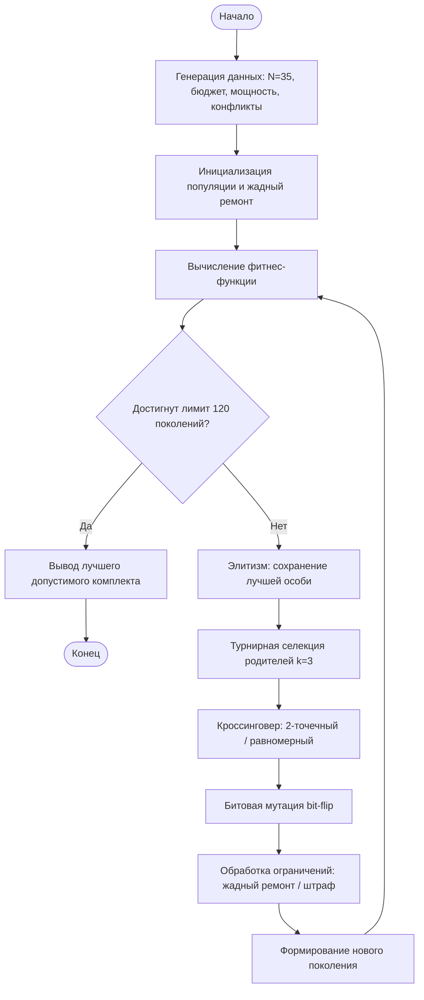
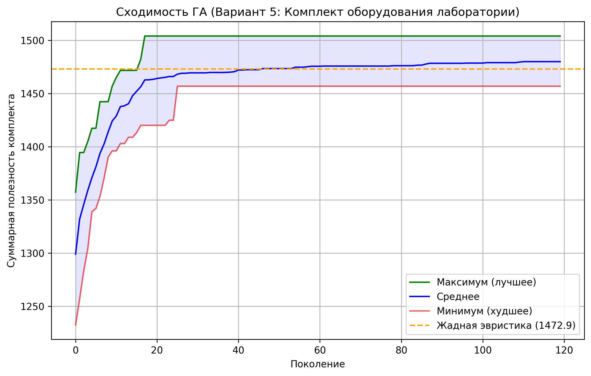

# ОТЧЕТ ПО ЛАБОРАТОРНОЙ РАБОТЕ № 2

* **Дисциплина:** Эволюционное программирование и генетические алгоритмы
* **Тема:** Генетический алгоритм для дискретной задачи с ограничениями
* **Студентка:** Кузьмина Валерия Евгеньевна
* **Группа:** Б24-527
* **Преподаватель:** Р. В. Душкин
* **Вариант:** 5 (Выбор комплекта оборудования для лаборатории при бюджете, мощности и совместимости)

---

## 1. Постановка задачи и индивидуальный вариант

Требуется разработать и исследовать генетический алгоритм для решения дискретной комбинаторной задачи оптимизации — формирования оптимального комплекта оборудования для лаборатории. Индивидуальный вариант № 5 определяет задачу выбора подмножества приборов максимальной суммарной полезности из доступного перечня при соблюдении ограничений на максимальный бюджет, суммарную потребляемую мощность и попарную совместимость оборудования.

---

## 2. Формальное описание пространства решений, целевой функции и ограничений

Пусть имеется набор из $N = 35$ единиц оборудования (удовлетворяет требованию масштаба $N \ge 30$). Каждый прибор $i \in \{0, \dots, 34\}$ характеризуется тремя параметрами:
* $u_i > 0$ — полезность (ценность) прибора для лаборатории;
* $c_i > 0$ — стоимость (тыс. руб.);
* $p_i > 0$ — потребляемая электрическая мощность (Вт).

Также задано множество пар несовместимого оборудования $E \subset \{0, \dots, 34\}^2$ ($|E| = 12$ конфликтующих пар), приборы из которых запрещено включать в комплект одновременно.

* **Пространство решений:** дискретное пространство двоичных векторов $X = \{0, 1\}^{35}$.
* **Целевая функция (максимизация суммарной полезности):**
  $$F(x) = \sum_{i=0}^{N-1} u_i x_i \to \max$$
* **Ограничения задачи:**
  1. Ограничение по бюджету:
     $$\sum_{i=0}^{N-1} c_i x_i \le B_{\max}, \quad B_{\max} = 962\text{ тыс. руб.}$$
  2. Ограничение по энергопотреблению:
     $$\sum_{i=0}^{N-1} p_i x_i \le P_{\max}, \quad P_{\max} = 4696\text{ Вт}$$
  3. Ограничение совместимости (отсутствие конфликтов):
     $$x_a + x_b \le 1 \quad \forall (a, b) \in E$$

Исходные данные сгенерированы программно с фиксацией генератора псевдослучайных чисел (`seed = 42`) и сохранены в файле `lab2_input_data.json`.

---

## 3. Выбранное представление особи и обоснование кодирования

Для кодирования решения используется **бинарная строка** фиксированной длины $N = 35$: $x = (x_0, x_1, \dots, x_{34})$, где $x_i \in \{0, 1\}$.

* **Генотип:** двоичный вектор из 35 бит.
* **Фенотип:** конкретный комплект приборов, включающий элементы с индексами $\{i \mid x_i = 1\}$.
* **Декодирование:** прямое отображение индексов единичных бит в спецификацию приборов.
* **Обоснование выбора:** бинарное представление естественным образом отражает структуру задачи выбора подмножества (задача о многомерном рюкзаке с конфликтами), где каждый прибор либо включается в комплект, либо нет. Размерность вектора строго равна числу объектов, что исключает избыточность кодирования.

### Примеры допустимых и недопустимых решений

В ходе предварительного тестирования сгенерированы примеры случайных бинарных векторов и проверено выполнение всех ограничений ($B_{\max} = 962$, $P_{\max} = 4696$, конфликты $= 0$):

| Тип решения | Полезность | Стоимость (тыс. руб.) | Мощность (Вт) | Число конфликтов | Причина статуса / Бинарный вектор |
| :--- | :---: | :---: | :---: | :---: | :--- |
| **Допустимое 1** | 896.3 | 708 | 3265 | 0 | Все лимиты соблюдены (`11000010100010011000000001000100001`) |
| **Допустимое 2** | 1077.5 | 820 | 4105 | 0 | Все лимиты соблюдены (`01000010000110010010011000101011010`) |
| **Недопустимое 1** | 1232.7 | 847 | 4362 | **2** | Нарушена совместимость (2 конфликта) (`01010001011001001100001000011101101`) |
| **Недопустимое 2** | 1398.0 | **1023** | **5672** | **2** | Перерасход бюджета (+61), мощности (+976), 2 конфликта (`01100111100000101010110011110110100`) |

---

## 4. Описание эволюционного алгоритма, операторов и методов обработки ограничений

Реализован дискретный генетический алгоритм со следующими параметрами:
* **Размер популяции:** $50$ особей.
* **Число поколений (критерий остановки):** $120$ поколений ($6000$ вычислений фитнес-функции за запуск).
* **Селекция:** турнирный отбор с размером турнира $k = 3$.
* **Операторы рекомбинации (сравниваемые):**
  1. *Двухточечный кроссинговер* (`two_point`, вероятность $p_c = 0.8$) — обмен центральным сегментом хромосом между двумя случайными точками разреза.
  2. *Равномерный кроссинговер* (`uniform`, вероятность $p_c = 0.8$) — независимый случайный выбор каждого бита от одного из родителей с вероятностью $0.5$.
* **Мутация:** инверсия каждого бита (`bit-flip`) с вероятностью $p_m = 1 / N \approx 0.0286$ (в среднем 1 ген на особь).
* **Элитизм:** лучшая особь поколения переносится в следующее поколение без изменений.
* **Способы обработки ограничений (сравниваемые):**
  1. *Метод жадного ремонта (`repair`):* после инициализации и операторов вариации недопустимая особь принудительно корректируется: сначала из каждой конфликтующей пары $(a, b)$ удаляется прибор с меньшей полезностью, затем последовательно исключаются выбранные приборы с наименьшей удельной полезностью $u_i / (c_i + 0.1 p_i)$ до выполнения лимитов бюджета и мощности.
  2. *Метод штрафных функций (`penalty`):* недопустимые особи остаются в популяции, но их фитнес снижается пропорционально величине нарушений:
     $$\text{Fitness}(x) = F(x) - \lambda \cdot \left(\max(0, C - B_{\max}) + \frac{\max(0, P - P_{\max})}{5} + 10 \cdot N_{\text{conf}}\right), \quad \lambda = 50$$

---

## 5. Блок-схема алгоритма

---

## 6. Обоснование выбора операторов относительно структуры задачи

Стандартные операторы кроссинговера и мутации для бинарных строк могут порождать недопустимые решения из-за объединения в одном потомке дорогих приборов или конфликтующих пар. Применение оператора **жадного ремонта** гарантирует $100\%$ допустимость популяции на каждом шаге эволюции и направляет поиск вдоль границы допустимой области, где расположены оптимальные комбинации. Двухточечный кроссинговер позволяет сохранять локальные сцепленные группы совместимых приборов лучше, чем равномерный кроссинговер, сильнее перемешивающий гены.

---

## 7. Результаты серии запусков и сравнительный анализ

Для каждой конфигурации проведено по $20$ независимых запусков с различными начальными значениями генератора (`seed` от 100 до 119). Также проведено сравнение с **конструктивной жадной эвристикой** (сортировка приборов по удельной полезности и последовательное добавление при сохранении допустимости).

| Алгоритм / Конфигурация | Лучшее (Max) | Среднее | Медиана | Худшее (Min) | Стд. откл. | Доля допустимых | Среднее время (сек) |
| :--- | :---: | :---: | :---: | :---: | :---: | :---: | :---: |
| **ГА: Ремонт + 2-точечный CX** | **1504.0** | 1479.93 | 1469.45 | **1456.9** | 18.06 | **100.0%** | 0.2080 |
| **ГА: Штрафы + 2-точечный CX** | **1504.0** | **1483.72** | **1486.40** | 1454.3 | **13.77** | 67.5% | 0.1339 |
| **ГА: Ремонт + Равномерный CX** | **1504.0** | 1474.37 | 1467.85 | **1456.9** | 15.87 | **100.0%** | 0.2624 |
| **Жадная эвристика (Baseline)** | 1472.9 | 1472.90 | 1472.90 | 1472.9 | 0.00 | 100.0% | 0.0001 |

### График сходимости

### Анализ экспериментов

1. **Сравнение подходов к ограничениям (`repair` против `penalty`):**
   Оба метода смогли найти глобальный оптимум задачи с полезностью **$1504.0$**. Метод штрафов показал чуть более высокое среднее значение среди лучших найденных решений ($1483.72$ против $1479.93$) и работал быстрее ($0.134$ с против $0.208$ с), поскольку не тратил время на циклы ремонта. Однако в финальной популяции при штрафном подходе лишь **$67.5\%$** особей являются допустимыми, тогда как метод ремонта обеспечивает **$100.0\%$** допустимость всех решений на каждом поколении.
2. **Сравнение операторов рекомбинации (`two_point` против `uniform`):**
   При использовании метода ремонта двухточечный кроссинговер показал более высокое среднее качество ($1479.93$ против $1474.37$) и меньшее время выполнения ($0.208$ с против $0.262$ с) по сравнению с равномерным кроссинговером, так как реже разрушает удачные комбинации приборов.
3. **Сравнение с жадной эвристикой:**
   Конструктивная жадная эвристика нашла решение с полезностью **$1472.9$**. Все три конфигурации генетического алгоритма превзошли жадный алгоритм как по лучшему результату ($1504.0$ против $1472.9$, прирост $+31.1$ единицы полезности), так и по среднему значению за серию запусков.

---

## 8. Лучшее найденное решение в предметном представлении

Лучший допустимый комплект оборудования найден генетическим алгоритмом и обеспечивает суммарную полезность **$1504.0$** при включении **19 приборов** из 35:
* **Итоговая стоимость комплекта:** $960$ тыс. руб. (при лимите $B_{\max} = 962$ тыс. руб., остаток бюджета — $2$ тыс. руб.).
* **Итоговая потребляемая мощность:** $4275$ Вт (при лимите $P_{\max} = 4696$ Вт, запас мощности — $421$ Вт).
* **Нарушения совместимости:** $0$ конфликтов.

| ID | Наименование прибора | Стоимость (тыс. руб.) | Мощность (Вт) | Полезность |
| :---: | :--- | :---: | :---: | :---: |
| 2 | Спектроанализатор #3 | 101 | 139 | 128.5 |
| 3 | Источник питания #4 | 18 | 145 | 38.2 |
| 4 | Мультиметр #5 | 92 | 77 | 134.7 |
| 6 | Сервер расчётов #7 | 50 | 56 | 76.6 |
| 9 | Спектроанализатор #10 | 27 | 417 | 61.6 |
| 10 | Источник питания #11 | 48 | 94 | 84.9 |
| 13 | Сервер расчётов #14 | 20 | 283 | 33.8 |
| 14 | Осциллограф #15 | 44 | 153 | 65.9 |
| 16 | Спектроанализатор #17 | 41 | 323 | 77.9 |
| 17 | Источник питания #18 | 24 | 225 | 40.2 |
| 18 | Мультиметр #19 | 35 | 523 | 62.3 |
| 19 | Логический анализатор #20 | 103 | 274 | 137.8 |
| 21 | Осциллограф #22 | 49 | 117 | 69.4 |
| 24 | Источник питания #25 | 46 | 319 | 78.9 |
| 27 | Сервер расчётов #28 | 29 | 206 | 53.9 |
| 28 | Осциллограф #29 | 91 | 115 | 121.3 |
| 30 | Спектроанализатор #31 | 16 | 167 | 42.4 |
| 31 | Источник питания #32 | 111 | 323 | 163.5 |
| 33 | Логический анализатор #34 | 15 | 319 | 32.2 |
| — | **ИТОГО (19 приборов)** | **960** | **4275** | **1504.0** |

---

## 9. Выводы и заключение

1. **Влияние механизмов обработки ограничений:** Метод жадного ремонта является предпочтительным для практических задач комплектации, так как гарантирует $100\%$ допустимость решений в популяции, тогда как метод штрафов позволяет алгоритму временно проходить через недопустимые области пространства поиска, повышая среднюю эффективность поиска за счёт риска снижения доли допустимых особей.
2. **Оценка качества результата:** Полученный результат ($F = 1504.0$) следует считать **высоким и полностью удовлетворяющим условиям задачи**. Генетический алгоритм преодолел локальный оптимум жадной эвристики ($1472.9$), утилизировал $99.8\%$ выделенного бюджета ($960$ из $962$ тыс. руб.), соблюдал ограничения по энергопотреблению и полностью исключил конфликты несовместимости оборудования.